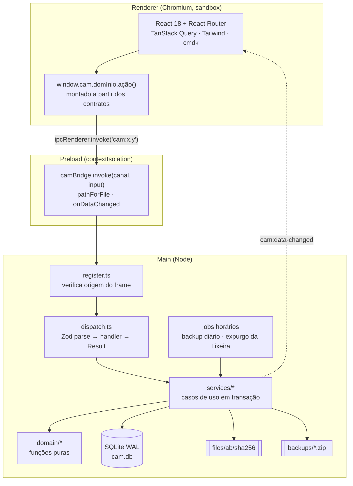
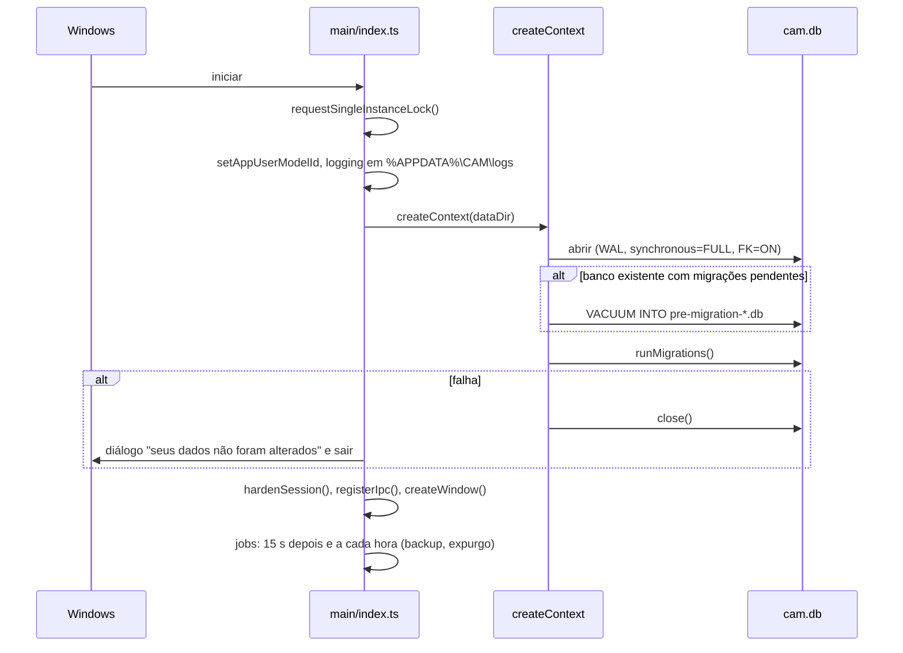

# Visão da arquitetura

Três processos do Electron, com fronteira rígida: o renderer (React) nunca acessa Node, disco ou banco. Toda operação é um canal IPC tipado, validado com Zod no processo principal e executado por um *service* transacional que não depende do Electron, e por isso é testável em Node puro.



## Camadas

| Pasta | Responsabilidade | Regra |
| --- | --- | --- |
| `src/shared` | Contratos IPC (Zod), enums, DTOs, `AppError` com código | Única fonte de tipos entre main e renderer |
| `src/main/db` | Schema Drizzle, migrações SQL versionadas, executor | Só para frente; nenhuma migração “down” |
| `src/main/domain` | Derivação do status, normalização, IDs | Puro, sem I/O; cobertura mínima de 80% |
| `src/main/services` | Candidaturas, eventos, notas, arquivos, busca, Lixeira, backup, auditoria | Cada escrita numa transação, incluindo índice de busca e auditoria |
| `src/main/ipc` | Handlers finos, dispatch, registro dos canais | Validar entrada, chamar um service, nada mais |
| `src/preload` | Ponte mínima: `invoke` genérico + 2 utilitários | Nome de canal validado por regex |
| `src/renderer` | Telas, componentes, i18n `pt-BR.ts` | Sem acesso a Node; dados via TanStack Query |

Em números: cerca de 5,1 mil linhas de TypeScript no processo principal e em `shared`, 79 canais IPC em `contracts.ts`, 29 tabelas (27 de domínio, `_migrations` e `search_index` FTS5).

## Ciclo de vida do processo principal



## Dados no disco

```text
%APPDATA%\CAM\            (ou CAM_DATA_DIR, usado pelos testes)
  cam.db                  SQLite: WAL, synchronous=FULL, foreign_keys=ON, busy_timeout=5000
  files/ab/<sha256>       anexos endereçados por conteúdo
  files/tmp/              escrita temporária antes do rename atômico
  backups/                manual-*, auto-*, pre-restore-* (.zip) e pre-migration-* (.db)
  logs/                   electron-log, sem texto de notas nem salários
```
