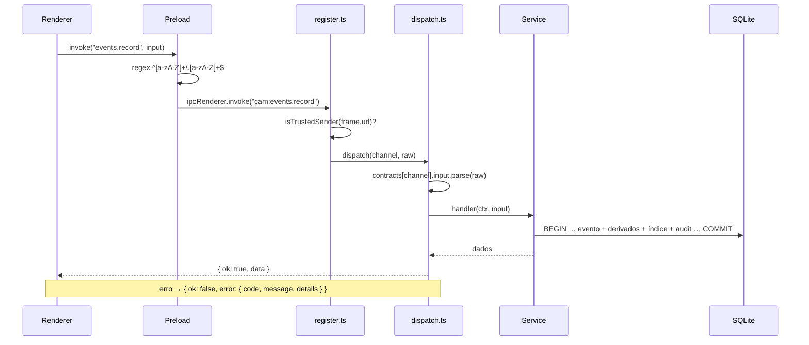

# IPC tipado

O renderer não conhece canais soltos. `src/shared/contracts.ts` declara cada canal com o schema Zod da entrada e o tipo da saída; o renderer monta `window.cam.<domínio>.<ação>()` a partir dessa lista, e o preload expõe só um `invoke` genérico.

## Fluxo de uma chamada



## Contrato de resposta

```ts
type Result<T> =
  | { ok: true; data: T }
  | { ok: false; error: { code: ErrorCode; message: string; details?: unknown } }
```

O renderer nunca recebe uma exceção crua: `dispatch` captura tudo e normaliza em `toErrorPayload`.

| Origem do erro | Código | Observação |
| --- | --- | --- |
| `AppError` lançado por um service | o próprio código | Mensagem já em português para a interface |
| `ZodError` | `VALIDATION` | `details` traz o caminho de cada campo |
| `SQLITE_BUSY` / `database is locked` | `DB_BUSY` | “Tente de novo” |
| Violação de `CHECK` ou FK | `CONFLICT` | A regra do banco vira erro legível |
| Qualquer outro | `UNEXPECTED` | Detalhe só no log |

O log registra canal e código, nunca o conteúdo da entrada: notas e salários não vão para disco fora do banco.

## Eventos do main para o renderer

Um único canal de saída, `cam:data-changed`, avisa que os dados mudaram por inteiro. Hoje ele só é emitido depois de restaurar um backup, e o renderer responde invalidando todo o cache do TanStack Query.
