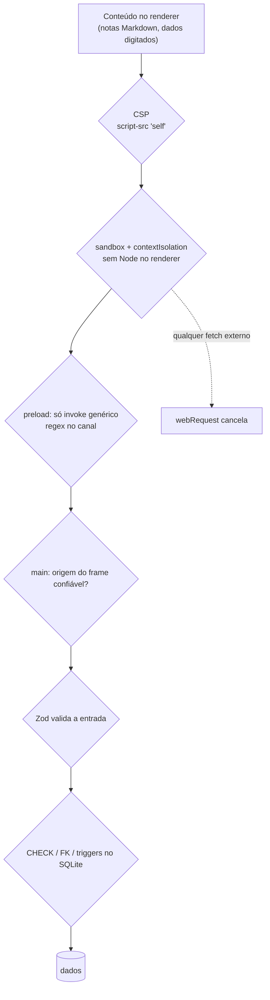

# Segurança

O modelo de ameaça é um app pessoal com dados sensíveis (salários, notas de entrevista, contatos). O objetivo é que nada saia da máquina e que conteúdo exibido não consiga executar código com acesso a Node.

## Controles

| Controle | Onde |
| --- | --- |
| `contextIsolation`, `sandbox`, `nodeIntegration: false`, `webSecurity` | `src/main/index.ts`, `createWindow` |
| CSP: `default-src 'self'`, `script-src 'self'`, `object-src 'none'`, `base-uri 'none'`, `form-action 'none'`, `frame-ancestors 'none'` | `src/renderer/index.html` |
| Navegação e novas janelas bloqueadas; links externos só `http(s)`, abertos no navegador do sistema | `will-navigate`, `setWindowOpenHandler` |
| Todas as permissões (câmera, notificações, etc.) negadas | `setPermissionRequestHandler`, `setPermissionCheckHandler` |
| Toda requisição de rede cancelada, exceto `file:`, `data:`, `blob:`, devtools e o dev server | `session.webRequest.onBeforeRequest` |
| IPC aceito só de frames com URL do próprio app | `isTrustedSender` em `register.ts` |
| Nome de canal validado por regex no preload | `src/preload/index.ts` |
| Sem atualização de componentes do Chromium nem pings de auditoria | `disable-component-update`, `no-pings` |
| Instância única: a segunda abertura foca a janela existente | `requestSingleInstanceLock` |
| Menu da aplicação removido em produção | `Menu.setApplicationMenu(null)` |

## Camadas de defesa

## Dados em repouso

Os dados ficam em `%APPDATA%\CAM`, protegidos pelas permissões da conta do Windows. Não há criptografia própria do banco na V1.0; quem tem acesso à conta tem acesso aos dados. Backups copiados para uma pasta extra (ex.: OneDrive) herdam a segurança dessa pasta.
