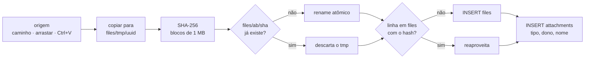

# Anexos

Os anexos usam armazenamento **endereçado por conteúdo**: cada arquivo é guardado uma vez, com o nome igual ao seu SHA-256, e pode ser ligado a qualquer número de registros.

## Propriedades

- Anexar o mesmo PDF em dez candidaturas guarda um só arquivo.
- Um crash no meio nunca deixa arquivo parcial com o nome final, porque o `rename` é atômico.
- Um rollback deixa no máximo um arquivo órfão, que a verificação de integridade aponta.
- Limite de 200 MB por arquivo; pastas são recusadas.
- O MIME é inferido pela extensão, sem ler o conteúdo.
- Excluir um anexo remove o vínculo (com Lixeira). Na exclusão definitiva, uma coleta de lixo remove os blobs que nenhum anexo referencia mais.

## Tipos de anexo

`attachments.kind` aceita: descrição da vaga, comprovante de candidatura, documento do recrutador, material de preparação, enunciado de teste, entregável, proposta e outro. O dono é exatamente um entre candidatura, entrevista, teste ou proposta, garantido por `CHECK`.
