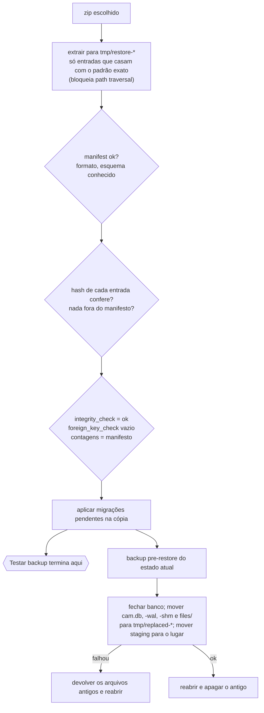

# Backup e restauração

## Tipos e retenção

| Tipo | Quando | Retenção |
| --- | --- | --- |
| `auto` | Job horário; cria se o último tem mais de 24 h (primeira checagem 15 s após abrir) | 14 diários + 1 por semana ISO por mais 8 semanas |
| `manual` | Botão em Configurações | Nunca apagado |
| `pre-restore` | Antes de toda restauração | 5 mais recentes |
| `pre-migration` (`.db`) | Antes de migrar um banco existente | 5 mais recentes |

`auto` e `manual` também são copiados, em melhor esforço, para uma pasta extra (ex.: OneDrive).

## Formato

```text
manual-20261116-170200-ab12cd.zip
  cam.db            snapshot consistente via VACUUM INTO, sem parar o app
  files/ab/<sha>    cada anexo referenciado pelo snapshot
  manifest.json     formato, versões do app e do esquema, contagem por tabela,
                    SHA-256 e tamanho de cada entrada
```

Se algum anexo referenciado não estiver no disco, o backup falha em vez de sair incompleto.

## Verificação e restauração



Qualquer problema em qualquer etapa encerra com “Nada foi alterado.”

## Testes

`tests/integration/backup.test.ts` cobre: ida e volta reproduz contagens e hashes; um byte corrompido é recusado e nada muda; zip que não é backup ou com caminhos inesperados é recusado; backup de esquema antigo é migrado; backup de esquema mais novo é recusado; backup diário roda uma vez a cada 24 h e a retenção mantém 14 diários + semanais; cópia para a pasta extra; backup antes de migrar.
