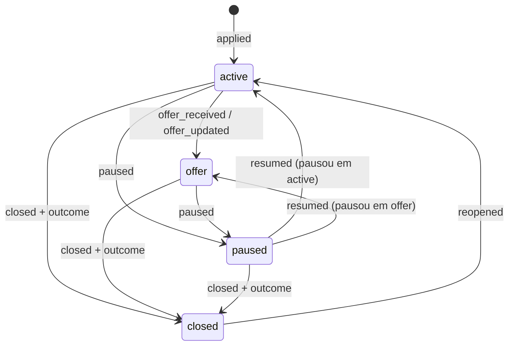
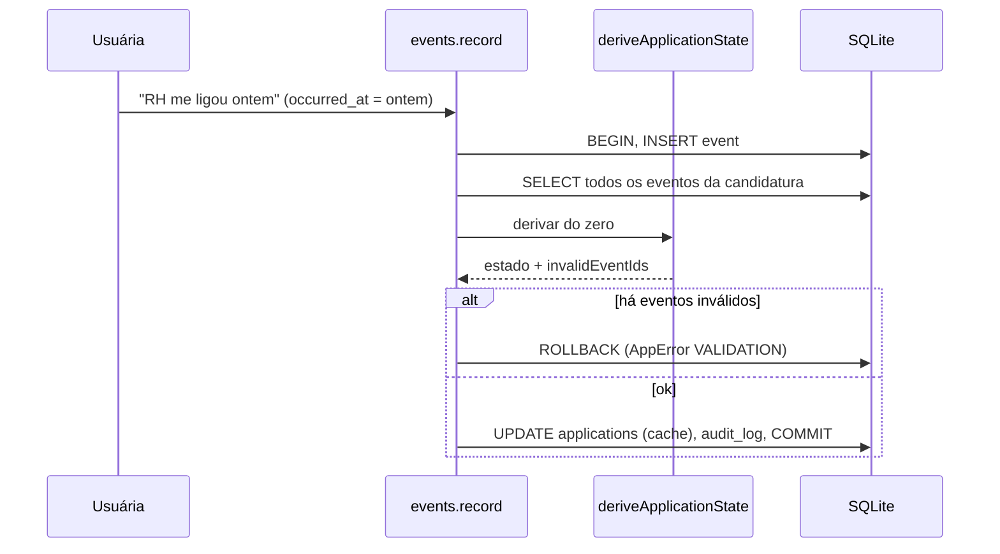

# Linha do tempo como fonte da verdade

Status, etapa atual, primeira e última resposta recebida e última atividade são um **cache** em `applications`, produzido por uma função pura: `deriveApplicationState(events)` em `src/main/domain/derive.ts`. Cada escrita de evento recalcula o cache na mesma transação. “Reconstruir dados derivados” roda a mesma função para todas as candidaturas.

## Máquina de estados

## Regras

- **Ordenação determinística**: `occurred_at`, depois `recorded_at`, depois `id`. Um evento retroativo entra no lugar certo e o estado é recalculado do zero, não aplicado por cima.
- **Eventos inválidos são recusados**: retomar sem pausa, reabrir sem encerramento, encerrar duas vezes. A função devolve `invalidEventIds` e o service rejeita a escrita.
- **Correção e anulação**: eventos nunca são apagados. Anular preenche `voided_at` e o motivo, e o evento sai da derivação. Corrigir gera histórico em `audit_log`.
- **Datas validadas**: evento no futuro (tolerância de 5 min) ou antes da data da candidatura é recusado.
- **Notas não contam como atividade**: `last_activity_at` ignora eventos do tipo `note`.

## Direção padrão

A direção (`in`/`out`) alimenta “primeira/última resposta”, base das futuras métricas de tempo de resposta.

| Evento | Direção padrão |
| --- | --- |
| `applied`, `follow_up_sent`, `assessment_submitted` | saída |
| `feedback_received`, `offer_received`, `offer_updated`, `assessment_received`, `stage_changed` | entrada |
| `closed` com desfecho `rejected` ou `position_cancelled` | entrada |
| demais | escolhida pela usuária |

## Exemplo: evento retroativo

::: tip Garantia testada
Um teste gera linhas do tempo aleatórias e compara o cache incremental com a reconstrução completa. Os dois precisam ser idênticos.
:::
