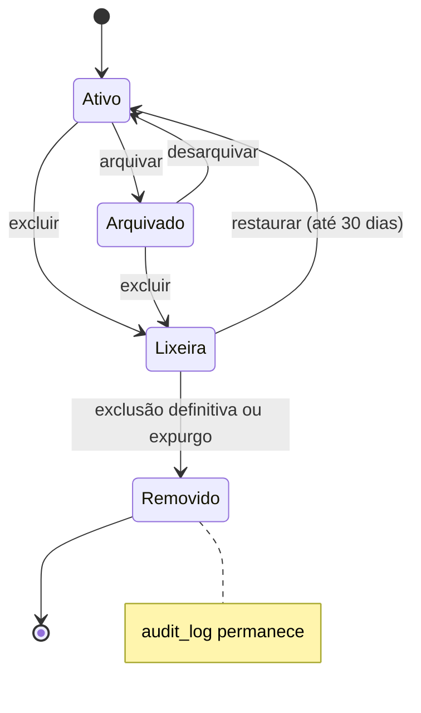

# Lixeira, auditoria e desfazer

| Mecanismo | Como funciona |
| --- | --- |
| Arquivar | `archived_at`; some da lista padrão e volta com o filtro “Mostrar arquivadas” |
| Excluir | Soft delete (`deleted_at`) em candidaturas, empresas, contatos, notas e anexos; vai para a Lixeira por 30 dias |
| Expurgo automático | Job horário; ordem anexos → notas → candidaturas → contatos → empresas; item com dependentes vivos é mantido |
| Exclusão definitiva | Só a partir da Lixeira, com confirmação digitada; empresa com candidaturas (mesmo na Lixeira) é recusada |
| Histórico de edições | `audit_log` com `{campo: [antes, depois]}`, só inserção; sobrevive à exclusão definitiva |
| Versões de nota | Autosave; no máximo uma revisão por minuto (uma nova gravação dentro de 60 s substitui a última); restauráveis |
| Desfazer (10 s, Ctrl+Z) | Toast no renderer com a ação inversa |

## Ações que podem ser desfeitas

| Ação | Inversa chamada |
| --- | --- |
| Cadastro rápido | `applications.undoCreate` |
| Arquivar candidatura | `applications.unarchive` |
| Candidatura para a Lixeira | `applications.restore` |
| Empresa para a Lixeira | `companies.restore` |
| Contato para a Lixeira | `contacts.restore` |
| Nota para a Lixeira | `notes.restore` |
| Anexo para a Lixeira | `attachments.restore` |

## Ciclo de vida de um registro

