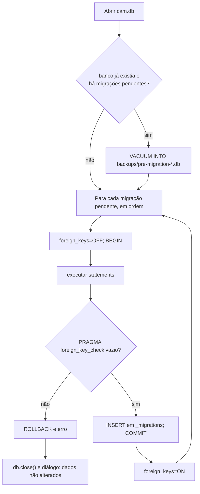

# Migrações

| Migração | Origem | Conteúdo |
| --- | --- | --- |
| `0000_init.sql` | Gerada pelo `drizzle-kit` a partir de `schema.ts` | 27 tabelas, índices, FKs, CHECKs |
| `0001_search_and_seed.sql` | Escrita à mão | FTS5, triggers de imutabilidade, dados iniciais |
| `0002_vagas1000.sql` | Escrita à mão | Vagas recebidas do vagas1000 e vínculo opcional com a candidatura |

O executor (`src/main/db/migrate.ts`) empacota os `.sql` no build via `import.meta.glob`, então o app instalado não depende de arquivos soltos. Cada arquivo é dividido nos marcadores `--> statement-breakpoint` do drizzle-kit, e as migrações aplicadas ficam registradas em `_migrations`.

## Fluxo

## Regras

- **Só para frente**: voltar atrás é restaurar o backup feito logo antes.
- `foreign_keys=OFF` durante a migração permite reconstruir tabelas, que é o padrão do SQLite para alterar colunas. A checagem antes do commit impede referências órfãs.
- Se abrir ou migrar falhar, o handle do banco é fechado antes de propagar o erro, para que o arquivo possa ser restaurado ou substituído no Windows. Essa correção veio de um [incidente de CI](/qualidade/ci).
- Backups antigos são migrados ao restaurar; backups de esquema mais novo que o app são recusados.
- Migração publicada não se edita: uma mudança de schema é sempre uma nova migração (`pnpm db:generate`).

## Testes

`tests/integration/migrations.test.ts` verifica que o schema completo é criado a partir de um banco vazio, que rodar de novo é idempotente e não duplica dados iniciais, e que uma migração com erro faz rollback mantendo as anteriores aplicadas.
