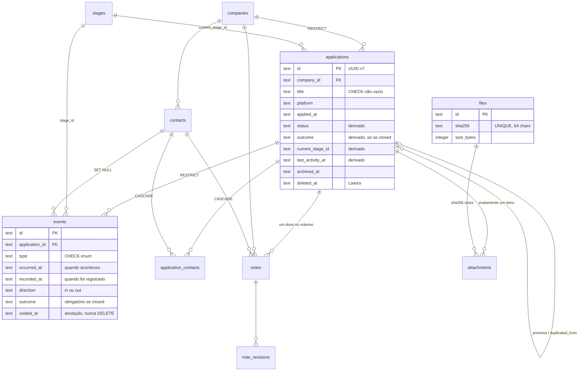

# Modelo de dados

O schema completo do planejamento (seção 8) foi criado já na V1.0, inclusive as tabelas que só terão tela na V1.1 (entrevistas, testes, propostas, tarefas, lembretes, documentos, metas). Motivo: nada registrado agora precisará de migração destrutiva depois.

## Núcleo usado pela V1.0

## Todas as tabelas

| Grupo | Tabelas | Uso na V1.0 |
| --- | --- | --- |
| Núcleo | `applications`, `companies`, `contacts`, `application_contacts`, `events`, `stages` | Completo |
| Conteúdo | `notes`, `note_revisions`, `note_templates`, `files`, `attachments` | Completo |
| Catálogos | `list_items`, `tags`, `taggings`, `settings` | Completo |
| Auditoria | `audit_log` | Completo |
| Processo seletivo | `interviews`, `interview_contacts`, `assessments`, `offers` | Só schema (V1.1) |
| Produtividade | `tasks`, `reminders`, `automation_rules`, `goals` | Só schema (V1.1) |
| Documentos | `documents`, `document_versions`, `templates` | Só schema (V1.1) |
| Infra | `_migrations`, `search_index` (FTS5) | Completo |
| Integração | `vagas1000_inbox` | Vagas pendentes recebidas localmente e vínculo com a candidatura |

## Integridade garantida pelo banco

| Regra | Mecanismo |
| --- | --- |
| Enums válidos (status, desfecho, senioridade, modalidade, tipo de evento…) | `CHECK … IN (…)` em cada coluna |
| Desfecho existe se e somente se a candidatura está encerrada | `CHECK ((status = 'closed') = (outcome IS NOT NULL))` |
| Faixa salarial coerente e moeda obrigatória quando há valor | `CHECK min <= max`, `length(currency) = 3` |
| `stage_changed` tem etapa; `closed` tem desfecho | `events_stage_required`, `events_outcome_required` |
| Nota com no máximo um dono; anexo com exatamente um dono | Soma de `IS NOT NULL` dentro de `CHECK` |
| Empresa única por nome normalizado, entre as não excluídas | Índice único parcial `companies(name_key) WHERE deleted_at IS NULL` |
| `audit_log` só de inserção | Triggers `BEFORE UPDATE/DELETE … RAISE(ABORT)` |
| Versão de currículo usada por uma candidatura é imutável | Trigger `document_versions_immutable_when_used` |
| Integridade referencial | FKs com `RESTRICT`, `CASCADE` ou `SET NULL` por relação; `foreign_keys=ON` em toda conexão |

## Convenções

- **Chaves**: UUID v7 em texto, ordenável por criação.
- **Datas**: texto ISO 8601 em UTC, comparável lexicograficamente.
- **Exclusão**: `deleted_at` (Lixeira) e `archived_at` (arquivo) em vez de `DELETE`.
- **Dados iniciais**: 9 etapas padrão, listas de plataforma, área e motivo de encerramento, modelos de nota e regras, inseridos pela migração `0001` com IDs fixos.

### Etapas padrão

| Etapa | Categoria |
| --- | --- |
| Candidatura enviada | applied (etapa inicial) |
| Contato do RH, Entrevista RH | screening |
| Teste técnico | assessment |
| Entrevista técnica, System design, Entrevista com gestor | interview |
| Entrevista final | final |
| Proposta | offer |

Etapas podem ser renomeadas e desativadas. Etapas já usadas não podem ser excluídas nem mudar de categoria, porque a categoria alimenta as métricas.
