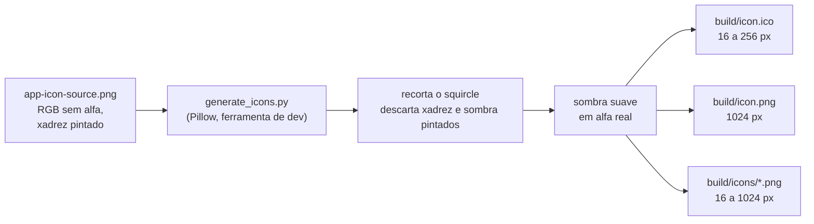

# Identidade visual

::: tip Entregue
O design system **Nevora** foi aplicado à interface no [PR #5](https://github.com/nataliatobiasdev/agregador-carreiras/pull/5) e o ícone novo entrou no [PR #7](https://github.com/nataliatobiasdev/agregador-carreiras/pull/7). Os dois estão na `main`.
:::

## Design system Nevora

O Nevora veio de um arquivo Figma Make (“Nevora Design System Showcase”). No app, os tokens vivem como variáveis CSS em `src/renderer/src/index.css` e são expostos ao Tailwind em `tailwind.config.js`. Os valores são canais RGB separados por espaço, para o Tailwind aplicar opacidade (`bg-accent/20`).

### Paleta

O tema escuro é a paleta de referência. O Nevora não define tema claro, então o claro usa os mesmos tons, escurecidos onde preciso para manter contraste AA sobre branco.

| Token | Papel | Escuro | Claro |
| --- | --- | --- | --- |
| `bg` | Fundo da janela |  `#0B0E19` |  `#F6F7FC` |
| `panel` | Superfície (cards, modais) |  `#151A2B` |  `#FFFFFF` |
| `subtle` | Hover, fundo secundário |  `#1C2238` |  `#EEF0F8` |
| `field` | Fundo de inputs (novo) |  `#0E121E` |  `#FAFBFF` |
| `accent` | Violeta, ação principal |  `#9D8CFF` |  `#6C5CE7` |
| `secondary` | Teal (novo) |  `#42D6CD` |  `#0D8A83` |
| `success` | Sucesso, oferta |  `#45D6A0` |  `#128058` |
| `warning` | Atenção, pausada |  `#F5C66B` |  `#9C6008` |
| `danger` | Erro, exclusão |  `#FF718D` |  `#CD2D50` |
| `fg` / `muted` | Texto principal / secundário | `#F4F6FF` / `#A6B1CB` | `#0B0E19` / `#525C78` |
| `overlay` | Fundo de modais (novo) | `#05070D` | `#0B0E19` |

### Tipografia

| Uso | Fonte | Classe |
| --- | --- | --- |
| Corpo | Inter Variable | `font-sans` |
| Títulos (`h1`–`h3`, modais) | Space Grotesk Variable | `font-heading` |
| Dados, datas, atalhos, cabeçalhos de tabela | JetBrains Mono Variable | `font-mono` |

As três vêm de pacotes `@fontsource-variable/*` e são **empacotadas com o app**. Carregar do Google Fonts violaria a CSP (`font-src 'self'`) e a regra de não fazer chamadas de rede.

### Raio e superfícies

| Token Tailwind | Valor | Uso |
| --- | --- | --- |
| `rounded-md` | 8 px | Inputs, botões |
| `rounded-lg` | 12 px | Cards internos |
| `rounded-xl` | 16 px | Painéis, modais |
| `rounded-2xl` | 24 px | Destaques |

`.surface` e `.surface-dialog` dão o acabamento “acetinado”: brilho interno de 1 px no topo e sombra cuja intensidade vem de `--shadow-strength` (0,08 no claro, 0,45 no escuro). No tema escuro o fundo tem uma iluminação atmosférica sutil (dois gradientes radiais, violeta e teal).

### Componentes

| Componente | Como ficou |
| --- | --- |
| `Button` | Estilo “Linear precision”: borda de 1 px e brilho interno; `danger` tingido em vez de sólido |
| Inputs, selects, textareas | Fundo `field`, foco violeta, altura de 36 px |
| `Badge` | Pill com `tone` semântico (`accent`, `secondary`, `success`, `warning`, `danger`) e ponto opcional |
| Status da candidatura | `statusTone`: ativa → `accent`, pausada → `warning`, oferta → `success`, encerrada → `neutral` |
| `Modal` e paleta Ctrl+K | Diálogo flutuante, fundo com blur, título em Space Grotesk |
| `Tabs` | Controle segmentado com gradiente violeta → teal |
| Menu lateral | Item ativo com borda esquerda violeta e gradiente |
| Tabelas | Superfície acetinada, cabeçalhos em mono |

## Ícone do app

Estrela-bússola sobre degraus, nas cores do Nevora. A arte original fica intacta em `build/icon-source/app-icon-source.png`.

### Pipeline

- O script falha se algum canto sair opaco, o que pegaria um recorte errado.
- **Legibilidade em tamanho pequeno:** até 48 px o squircle ocupa quase o quadro inteiro e fica sem sombra; até 32 px o símbolo é ampliado e o brilho do canto sai, porque viraria um pixel solto.
- O `.ico` tem os tamanhos 16, 20, 24, 32, 40, 48, 64, 128 e 256 px.

### Onde é usado

| Lugar | Configuração |
| --- | --- |
| Executável e atalhos | `win.icon: build/icon.ico` em `electron-builder.yml` |
| Instalador, desinstalador e cabeçalho do NSIS | `installerIcon`, `uninstallerIcon`, `installerHeaderIcon` |
| Janela (dev e Linux) | `BrowserWindow({ icon })` com import `?asset` do electron-vite |
| Linux | `linux.icon: build/icons` |
| Este site | Logo e favicon |

A bandeja ainda não existe (planejada na [R1.1](/roadmap)); quando entrar, deve usar o mesmo `build/icon.ico`.
