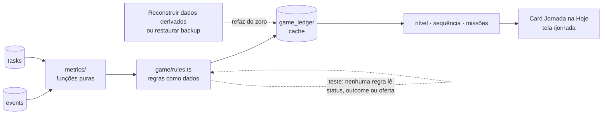

# Jornada (R1.2) planejado

::: warning Ainda não existe no app
Esta página descreve a gamificação proposta nos planos de 16/11/2026. Nada aqui está no código. Ela depende da [Rotina diária](/planejado/rotina), porque missões e sequências precisam de tarefas e follow-ups para medir.
:::

**Objetivo:** transformar uma busca longa e com pouco retorno em progresso visível toda semana, medido só pelo que a usuária faz, mesmo quando as empresas ficam em silêncio.

## Regras de integridade

Estas regras são inegociáveis no plano e cada uma tem teste previsto.

| Regra | O que significa |
| --- | --- |
| O jogo lê, nunca escreve | Pontos são cache derivado de eventos, tarefas e notas, recalculável do zero, como o status hoje. Nenhuma métrica lê pontos. |
| Só conta o que está registrado | Cada ponto aponta para o registro que o gerou. Anular o registro anula os pontos. |
| Processo, não resultado | Resposta, entrevista e oferta da empresa nunca dão pontos. Registrar uma rejeição vale o mesmo que registrar um convite. |
| Sem culpa | Pontos e nível nunca caem. Sem vermelho, sem streak diário, sem cobrança, sem ranking, sem aleatoriedade. |
| Ritmo semanal | A sequência conta semanas com as metas batidas. Pausas (férias, doença, provas) congelam. |
| Quantidade com teto | Limites diários para não premiar candidatura em massa. |
| Desligável | Um interruptor some com toda a interface do jogo; o modo discreto mostra só as missões, sem números. |

## Pontos previstos

| Ação | Pontos | Limite |
| --- | --- | --- |
| Candidatura registrada | 10 | 8 por dia |
| Follow-up confirmado | 8 | 1 por candidatura por semana |
| Resposta registrada (positiva ou negativa) | 3 | |
| Encerrar candidatura parada há 30+ dias | 3 | |
| Tarefa concluída | 3 | 10 por dia |
| Backup testado | 5 | 1 por semana |

Regras de dossiê, preparação, debrief e cases STAR ficam escritas e inativas até a R1.3.

## Mecânicas

- **Nível:** passar do nível *n* para *n*+1 pede 100 × *n* pontos. O nível exibido nunca cai: o maior já alcançado fica guardado.
- **Metas semanais:** 1 a 3, definidas pela usuária (candidaturas, follow-ups, tarefas, backups testados). Entrevistas não entram como meta.
- **Sequência semanal:** semanas seguidas com todas as metas; a semana atual só conta ao terminar; “melhor sequência” sempre visível.
- **Missões diárias:** até 3, geradas dos dados (follow-up atrasado, tarefa de hoje, sugestão pendente, candidatura sem evento há 14 dias). Determinísticas; ignorar não tem efeito; não dão pontos extras.
- **Registro retroativo:** vale a data da ação para a sequência se registrado em até 7 dias.

## Arquitetura prevista

## Mudanças planejadas no banco

O número da migração será definido na implementação, após as migrações já existentes e as que forem entregues antes da Jornada.

Novas tabelas `game_ledger` (único em regra + origem) e `game_pauses`; `goals` reconstruída com mais métricas. `game_ledger` vai no backup, mas restaurar sempre a reconstrói.

## Visual no Nevora

Barra de nível segmentada em `accent`, missões concluídas em `secondary`, mapa da semana com 7 casas em `success` ou `subtle`. `warning` e `danger` nunca aparecem no jogo. Aviso de nível curto, sem confete, respeitando movimento reduzido.

## Decisões em aberto

Jornada ligada por padrão, sequência semanal ou diária, metas iniciais e títulos de nível ainda dependem da Natalia. Ver [Decisões em aberto](/roadmap#decisoes-em-aberto).
