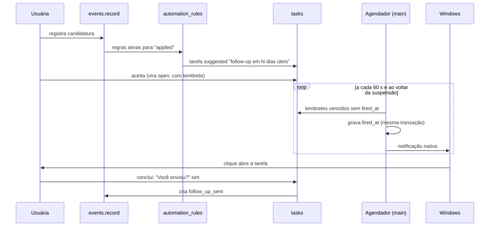

# Rotina diária (R1.1) planejado

::: warning Ainda não existe no app
Esta página descreve o plano “Plano de implementação: rotina diária e Jornada” (16/11/2026). Nada aqui está no código. As tabelas `tasks`, `reminders` e `automation_rules` já existem desde a V1.0, mas sem serviço nem tela.
:::

**Objetivo:** o app avisa o que fazer e continua rodando com a janela fechada. Hoje ele é um bom cofre, mas não puxa a usuária de volta.

## O que entra

| ID | Funcionalidade | Aceite principal |
| --- | --- | --- |
| B1 | Serviço de tarefas: criar (solta ou ligada a candidatura), editar, concluir, adiar, cancelar | Teste para cada transição; trilha em `audit_log` |
| B2 | Regras sugeridas: um evento dispara regras ativas que criam tarefa `suggested`; a usuária aceita ou dispensa | Índice único `(rule_id, trigger_event_id)` impede duplicata; anular o evento cancela a sugestão |
| B3 | Concluir follow-up pergunta “Você enviou?”; sim cria `follow_up_sent` | Concluir sem confirmar não cria evento |
| B4 | Agendador no processo principal, a cada 60 s e ao voltar da suspensão | `fired_at` gravado na mesma transação antes de notificar; nenhum disparo duplo |
| B5 | Lembretes perdidos viram uma notificação-resumo e um bloco na tela Hoje | 5 vencidos → 1 notificação, 5 itens |
| B6 | Notificação nativa do Windows; clique abre a tarefa | Usa o `AppUserModelId` atual |
| B7 | Bandeja: fechar a janela esconde; só “Sair” encerra | Lembrete e backup rodam com a janela fechada |
| B8 | Iniciar com o Windows (desligado por padrão) | Interruptor reflete o estado real |
| B9 | Tela **Hoje** como inicial: atrasadas, hoje, sugestões, próximos 7 dias, lembretes perdidos, paradas há 14 dias | Cada item se resolve em até 2 cliques |
| B10–B12 | Aba Tarefas no detalhe; tarefas na busca e no cadastro rápido; configurações de rotina | |
| B13 | Esta documentação atualizada | Site compila |

## Como deve funcionar

## Mudanças planejadas no banco

O número da migração será definido na implementação; `0002_vagas1000.sql` já está em uso.

Aditivas: índice `tasks(application_id, status)`, índice único `reminders(task_id, remind_at)`, coluna opcional `tasks.notes` e as chaves de configuração `reminders.defaultTime`, `notifications.enabled`, `app.closeToTray` e `app.openAtLogin`.

## Riscos tratados no plano

| Risco | Mitigação |
| --- | --- |
| Lembrete duplicado ou perdido | `fired_at` antes de notificar; resumo de perdidos; teste com relógio falso |
| Processo órfão ou duas instâncias | A trava de instância única já existe; “Sair” fecha o banco em `will-quit` |
| Notificação como brecha | Notificações só no processo principal; `cam:navigate` aceita só rotas internas validadas por Zod |

## Antes desta release: R1.0.1 e R1.0.2

A R1.0.1 (sem migração) prepara a base: tela Sobre com versão, indicador de último backup, atalhos completos, detalhe quebrado em componentes, teste de acessibilidade e, principalmente, um **banco de referência V1.0** com teste de atualização, que passa a validar toda migração futura. A R1.0.2 cifra a cópia de backup que vai para a pasta extra (OneDrive). Ver o [Roadmap](/roadmap).
