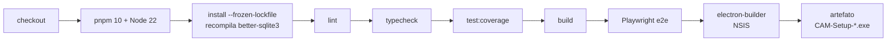
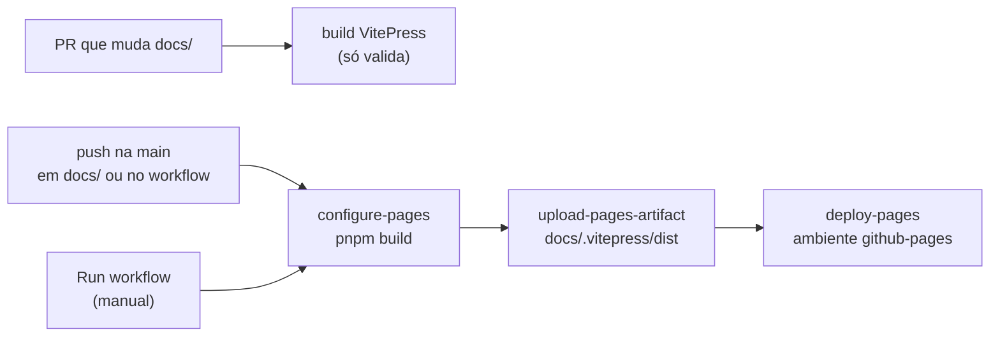

# CI e incidentes

Workflow `.github/workflows/ci.yml` em `windows-latest`, em todo PR e push na `main`, com timeout de 30 min.

## Histórico do PR #1

| Run | Commit | Resultado | Causa | Correção |
| --- | --- | --- | --- | --- |
| #1 | `15bd9f6` | falhou | `pnpm install`: `@electron/rebuild` fixa `node-gyp` numa URL git via SSH (`git@github.com:electron/node-gyp.git`); o runner não tem chave SSH | `3f0ff2d`: `pnpm.overrides` aponta `@electron/node-gyp` para o mesmo fork publicado no npm, `10.2.0-electron.1` |
| #2 | `3f0ff2d` | falhou | No Windows um arquivo SQLite aberto não pode ser apagado. A limpeza dos testes removia a pasta temporária antes de fechar o banco → `EBUSY` | `8e0ecfc`: limpezas em ordem LIFO (fecha o banco antes de apagar a pasta) e `createContext` fecha o handle se a migração falhar |
| #3 | `8e0ecfc` | passou | | Lint, typecheck, 72 testes, 6 e2e e instalador gerado |
| #4 | `82cc2ae` | passou | | Mesmo pipeline na `main` após o merge |

## Postmortem resumido

::: warning Por que só o CI pegou
As duas falhas só aparecem no Windows. O desenvolvimento foi feito em Linux, onde apagar um arquivo aberto funciona e a rede do ambiente resolvia a dependência git. O CI em `windows-latest` é o que garante o alvo real.
:::

- **Incidente 1, dependência via SSH.** Dependência transitiva com URL `git+ssh` quebra qualquer ambiente sem chave. A correção fixa a versão publicada no npm, que também torna o lockfile reprodutível.
- **Incidente 2, arquivo travado.** A ordem de limpeza dos testes estava invertida. A correção também melhorou o app: se a migração falhar ao abrir, o banco é fechado, então o arquivo pode ser restaurado ou substituído sem reiniciar o Windows.

## Documentação e GitHub Pages

O workflow `.github/workflows/docs.yml` roda em Ubuntu e é **o único que publica no Pages**. Ele é independente do CI do app.

| Configuração | Valor |
| --- | --- |
| Fonte do Pages (Settings → Pages) | **GitHub Actions** |
| Disparo | PR (só build), push na `main` em `docs/**` ou no próprio workflow, manual |
| Concorrência | Um deploy por ref; o mais novo cancela o anterior |
| Histórico completo (`fetch-depth: 0`) | Necessário para “Atualizado em” de cada página |

### Incidente 3: site substituído pela raiz do repositório

| Quando | O que aconteceu |
| --- | --- |
| 15h03 | Merge do [PR #3](https://github.com/nataliatobiasdev/agregador-carreiras/pull/3); o workflow Docs publica o site VitePress (build e deploy verdes) |
| 15h08 | Um `static.yml` (modelo “Static HTML” do GitHub) entra na `main` e publica a raiz do repositório (`path: '.'`) por cima do site |
| 15h16 | Merge do [PR #4](https://github.com/nataliatobiasdev/agregador-carreiras/pull/4): remove o `static.yml` e o Docs republica o site |

Horários de Brasília, 16/11/2026.

- **Causa:** dois workflows publicando no mesmo ambiente `github-pages`; vence o último deploy.
- **Correção:** um só workflow publica. `docs.yml` ganhou `actions/configure-pages` e um comentário que proíbe um segundo publicador; como o arquivo mudou, o merge disparou o novo deploy.
- **Lição:** ao trocar a fonte do Pages para “GitHub Actions”, o GitHub sugere modelos prontos. Não é preciso criar nenhum: o workflow do repositório já cobre o deploy.
