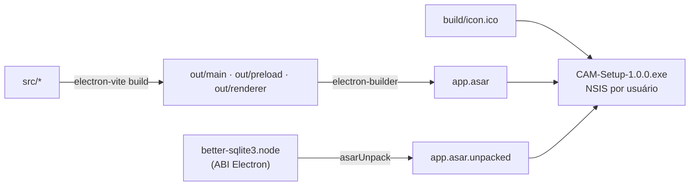

# Instalador Windows

| Configuração (`electron-builder.yml`) | Efeito |
| --- | --- |
| `target: nsis`, `arch: x64` | Instalador `CAM-Setup-1.0.0.exe` |
| `perMachine: false`, `allowElevation: false` | Instalação por usuário, sem administrador |
| `oneClick: false`, `allowToChangeInstallationDirectory: true` | Assistente com escolha de pasta |
| Atalhos na área de trabalho e no menu Iniciar | Nome “Career Application Manager” |
| `deleteAppDataOnUninstall: false` | Desinstalar nunca apaga `%APPDATA%\CAM` |
| `asarUnpack` de `better-sqlite3`, `bindings`, `file-uri-to-path` | O `.node` nativo fica fora do asar para poder ser carregado |
| `npmRebuild: true` + `postinstall: electron-builder install-app-deps` | Módulo nativo compilado para o ABI do Electron 38 |
| `appId: com.nataliatobias.cam` = `setAppUserModelId` | Necessário para notificações nativas (V1.1) |
| `win.icon`, `installerIcon`, `uninstallerIcon`, `installerHeaderIcon` = `build/icon.ico` | Ícone no executável, atalhos, instalador e desinstalador ([PR #7](https://github.com/nataliatobiasdev/agregador-carreiras/pull/7)) |
| `linux.icon: build/icons` | PNGs de 16 a 1024 px para o build Linux |

## Como obter

- **CI**: aba Actions → run verde → artefato `installer`.
- **Local** numa máquina Windows: `pnpm dist`, saída em `dist/`.

## Pendências

::: info Sem assinatura de código
O instalador não é assinado. Na primeira execução o SmartScreen mostra “Editor desconhecido”: clique em **Mais informações → Executar assim mesmo**.
:::

## Ícone

O `.ico` multi-tamanho (16 a 256 px) e os PNGs são gerados de uma arte única por `scripts/icons/generate_icons.py`, uma ferramenta de desenvolvimento que não roda no build. Detalhes em [Identidade visual](/guia/identidade-visual#icone-do-app).

## Pacote

