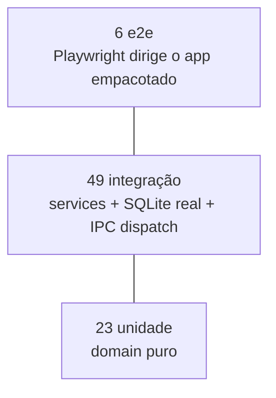

# Testes

<div class="stats">
  <div><b>23</b><span>unitários</span></div>
  <div><b>49</b><span>integração</span></div>
  <div><b>6</b><span>ponta a ponta</span></div>
  <div><b>80%</b><span>cobertura mínima em domain</span></div>
</div>

| Nível | Ferramenta | Qtd. | O que cobre |
| --- | --- | --- | --- |
| Unidade | Vitest | 23 | Derivação de status, normalização, formatação |
| Integração | Vitest + SQLite real em pasta temporária | 49 | Candidaturas, eventos retroativos, restrições do banco, histórico, Lixeira, anexos, busca, IPC (dispatch), migrações, backup |
| Ponta a ponta | Playwright + Electron (build real) | 6 | Cadastro só com teclado; mudar etapa; anexar o mesmo arquivo duas vezes; Ctrl+K sem acento; excluir e restaurar; criar e testar backup |

## Pirâmide



## Decisões de teste

- **Vitest roda dentro do Node do Electron**. `scripts/run-vitest.mjs` inicia o Vitest com `ELECTRON_RUN_AS_NODE=1`. Assim só existe um build do better-sqlite3 em `node_modules`, o do ABI do Electron, e os testes usam exatamente o binário que vai no instalador.
- **Mesmo `createContext` do app**. Os testes de integração criam o contexto com relógio controlável e `CAM_DATA_DIR` temporário, sem mocks do banco.
- **Equivalência por propriedade**. Linhas do tempo aleatórias: o cache incremental tem que ser igual à reconstrução completa.
- **Cobertura** (v8) sobre `domain`, `services` e `shared`, com limite de 80% em linhas, funções, branches e statements para `src/main/domain`.
- **Playwright** com 1 worker, `trace: off` e screenshot só em falha.

## Arquivos

```text
tests/
  unit/          derive · format · normalize
  integration/   applications · events · notes-files-search · ipc · migrations · backup
  e2e/           app.spec.ts
  helpers/       context.ts (contexto temporário + limpeza LIFO)
```
