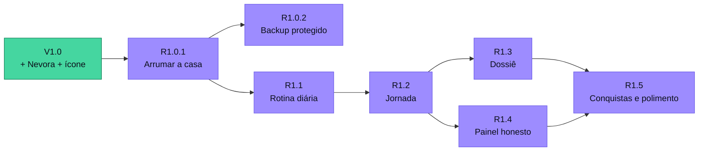

# Limitações e roadmap

::: info Como ler esta página
entregue está na `main` e documentado nas outras páginas. planejado é intenção dos planos de produto, ainda sem código. em aberto depende de uma decisão da Natalia.
:::

## Onde estamos

| Entrega | Estado | Onde |
| --- | --- | --- |
| V1.0: registro confiável | entregue | [PR #1](https://github.com/nataliatobiasdev/agregador-carreiras/pull/1) |
| Documentação no GitHub Pages | entregue | PRs [#2](https://github.com/nataliatobiasdev/agregador-carreiras/pull/2), [#3](https://github.com/nataliatobiasdev/agregador-carreiras/pull/3) e [#4](https://github.com/nataliatobiasdev/agregador-carreiras/pull/4) |
| Design system Nevora | entregue | [PR #5](https://github.com/nataliatobiasdev/agregador-carreiras/pull/5) · [Identidade visual](/guia/identidade-visual) |
| Ícone novo do app | entregue | [PR #7](https://github.com/nataliatobiasdev/agregador-carreiras/pull/7) · [Identidade visual](/guia/identidade-visual#icone-do-app) |
| Vagas pendentes do vagas1000 | entregue | [PR #9](https://github.com/nataliatobiasdev/agregador-carreiras/pull/9) · [Como usar](/guia/funcionalidades#vagas-recebidas-do-vagas1000) |
| R1.0.1 a R1.5 | planejado | Abaixo |

## Releases planejadas

Os planos “Autocrítica e plano de melhorias” e “Plano de implementação: rotina diária e Jornada” (16/11/2026) dividem o próximo trecho em releases pequenas, cada uma instalável e útil sozinha. Nada abaixo existe no código ainda.

| Release | Conteúdo | Migração | Esforço estimado |
| --- | --- | --- | --- |
| **R1.0.1** Arrumar a casa | Rótulo na coluna Plataforma, atalhos Ctrl+1–7, cor da janela pelo tema, tela Sobre com versão e link de Releases, indicador “último backup”, quebrar o detalhe em componentes, invalidação de cache por domínio, movimento reduzido e texto mínimo de 12 px, teste de acessibilidade (axe), banco de referência V1.0 e teste de atualização, workflow de Release por tag | Nenhuma | 2 a 3 dias |
| **R1.0.2** Backup protegido | Cópia da pasta extra em zip AES-256, senha guardada com `safeStorage`, restaurar pedindo senha | Nenhuma | 1 a 2 dias |
| **R1.1** Rotina diária | Tarefas, follow-up confirmado, lembretes e notificação nativa, bandeja, iniciar com o Windows, tela Hoje · [detalhes](/planejado/rotina) | `0002_routine` | 6 a 8 dias |
| **R1.2** Jornada | Pontos, nível, metas e sequência semanais, missões diárias, tudo desligável · [detalhes](/planejado/jornada) | `0003_journey` | 5 a 7 dias |
| **R1.3** Dossiê | Aba Contexto, cases STAR, plano de etapas previsto × realizado, entrevistas como entidade | A definir | 8 a 10 dias |
| **R1.4** Painel honesto | Volume, funil, tempo de resposta, silêncio × rejeição; percentuais ocultos com n < 5; CSV | A definir | 4 a 5 dias |
| **R1.5** Conquistas e polimento | Conquistas e marcos, kanban, painel lateral no lugar da página de detalhe, relatório semanal | A definir | 5 a 6 dias |

Regras que valem para todas: sem scraping no CAM; a integração local com o vagas1000 preserva a confirmação manual da candidatura. A rede continua bloqueada, as interfaces usam os tokens Nevora e as migrações são só para frente, com backup antes.

## Decisões em aberto

| # | Pergunta | Recomendação do plano | Estado |
| --- | --- | --- | --- |
| 1 | Rotina (R1.1) antes do dossiê (R1.3)? | Rotina primeiro | em aberto |
| 2 | Jornada ligada por padrão? | Ligada, com modo discreto a um clique | em aberto |
| 3 | Sequência semanal ou diária? | Semanal, com pausa que congela | em aberto |
| 4 | Metas iniciais por semana | Sem recomendação: o número é da Natalia | em aberto |
| 5 | Títulos de nível | Aprendiz → Mestra da Jornada | em aberto |
| 6 | Atualização manual ou checagem de versão? | Manual, com link para Releases | em aberto |
| 7 | Backup na nuvem com senha já? | Já, se usa a pasta do OneDrive | em aberto |

## Adiado conscientemente da V1.0

Itens que estavam no planejamento v2 e ficaram de fora da V1.0. A coluna Destino segue as releases acima.

| Item | Por quê | Destino |
| --- | --- | --- |
| Aba Contexto (dossiê: empresa, matriz requisitos × evidências, cases STAR, pitch) | Precisa de modelagem própria, fora do schema da seção 8 | R1.3 |
| Plano de etapas previsto × realizado | Depende de um modelo de processo por vaga (detectado da descrição ou padrão) | R1.3 |
| Tarefas, lembretes, notificações do Windows, bandeja, iniciar com o Windows | Escopo de acompanhamento diário | R1.1 (tabelas já existem) |
| Tela Hoje | Idem | R1.1 |
| Kanban | Visualização alternativa | R1.5 |
| Entrevistas como entidade com preparação e debrief | Hoje são registrados como eventos | R1.3 (tabelas já existem) |
| Currículo enviado por candidatura | Sem tela | R1.3 (tabelas e trigger já existem) |
| Dashboard e exportação CSV | Analytics | R1.4 |
| Metas | Hábito semanal | R1.2 (`goals` já existe) |
| Modelos de cadastro rápido | `templates` sem tela | A definir |
| Assinatura de código do instalador | Exige certificado | A definir |

## Limitações técnicas atuais

- Fechar a janela encerra o app (sem bandeja); backup automático e expurgo só rodam com o app aberto. A bandeja está na R1.1.
- Ctrl+1–7 só mapeia duas telas (Ctrl+2 Candidaturas, Ctrl+5 Empresas). Correção na R1.0.1.
- A coluna Plataforma na tabela exibe a chave interna (`linkedin_easy_apply`, `company_site`) em vez do rótulo da lista. Correção na R1.0.1.
- Datas e números via `Intl`, sem biblioteca de i18n; só pt-BR.
- A busca não indexa o conteúdo dos anexos, só o nome.
- MIME por extensão; sem pré-visualização de PDF dentro do app.
- Sem sincronização entre máquinas; a pasta extra de backup é a estratégia de cópia externa.
- Sem criptografia própria do banco; a cópia na pasta extra sai em texto claro. Zip com senha na R1.0.2.
- O build Linux existe só como `dir` para testes; o alvo suportado é Windows x64.
- O app ainda não mostra a própria versão nem avisa de versão nova. Tela Sobre e Releases na R1.0.1.
