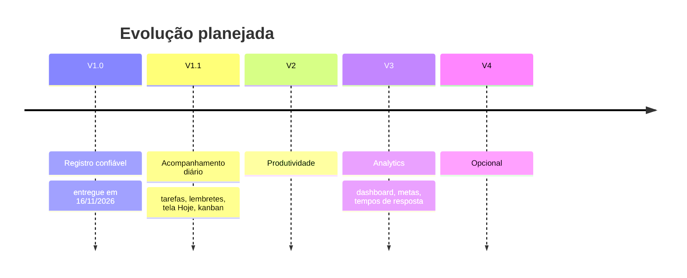

# Limitações e roadmap

## Roadmap

As versões depois da V1.1 vêm do planejamento de produto e ainda não têm escopo técnico fechado.

## Adiado conscientemente da V1.0

| Item | Por quê | Destino |
| --- | --- | --- |
| Aba Contexto (dossiê: empresa, matriz requisitos × evidências, cases STAR, pitch) | Precisa de modelagem própria, fora do schema da seção 8 | Próxima versão, com migração nova |
| Plano de etapas previsto × realizado | Depende de um modelo de processo por vaga (detectado da descrição ou padrão) | Próxima versão |
| Tarefas, lembretes, notificações do Windows, bandeja, iniciar com o Windows | Escopo de acompanhamento diário | V1.1 (tabelas já existem) |
| Tela Hoje, kanban, agenda | Idem | V1.1 |
| Entrevistas, testes e propostas como entidades com tela | Hoje são registrados como eventos | V1.1 (tabelas já existem) |
| Biblioteca de currículos versionados; currículo enviado por candidatura | Sem tela | V1.1 (tabelas e trigger já existem) |
| Dashboard, metas, exportação CSV | Analytics | V1.1/V3 (`goals` já existe) |
| Modelos de cadastro rápido | `templates` sem tela | V1.1 |
| Assinatura de código | Exige certificado | A definir |

## Limitações técnicas atuais

- Fechar a janela encerra o app (sem bandeja); backup automático e expurgo só rodam com o app aberto.
- Ctrl+1–7 só mapeia as telas existentes (Ctrl+2 Candidaturas, Ctrl+5 Empresas).
- A coluna Plataforma na tabela exibe a chave interna (`linkedin_easy_apply`, `company_site`) em vez do rótulo da lista.
- Datas e números via `Intl`, sem biblioteca de i18n; só pt-BR.
- A busca não indexa o conteúdo dos anexos, só o nome.
- MIME por extensão; sem pré-visualização de PDF dentro do app.
- Sem sincronização entre máquinas; a pasta extra de backup é a estratégia de cópia externa.
- Sem criptografia própria do banco.
- O build Linux existe só como `dir` para testes; o alvo suportado é Windows x64.
